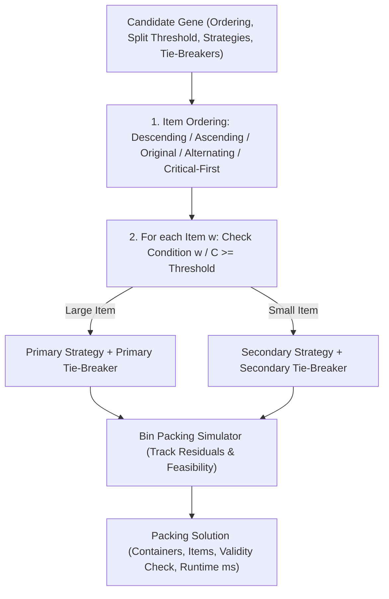

# DarwinLab: Evolutionary Algorithm Discovery Platform

[](https://www.python.org/)
[](https://opensource.org/licenses/MIT)
[]()

**DarwinLab** is an interactive, reproducible computational platform for discovering, refining, and benchmarking candidate heuristics for the one-dimensional bin-packing problem using evolutionary computation.

---

## 1. Project Overview & Research Question

### The Bin Packing Problem
Given:
- A set of $N$ items with positive weights/sizes $w_i \in (0, C]$.
- Containers (bins) of uniform fixed capacity $C > 0$.

**Objective**: Assign every item to a container such that the sum of item sizes in each container does not exceed $C$, while minimizing the total number of containers used:

$$\min M \quad \text{subject to} \quad \sum_{i \in \text{Bin}_j} w_i \le C, \quad \forall j \in \{1, \dots, M\}$$

### The Research Question
> *Can evolutionary search over a safe, bounded grammar of heuristic components discover hyper-heuristics that match or exceed classical deterministic algorithms (such as First Fit, Best Fit, and First Fit Decreasing) across diverse instance distributions?*

### Theoretical Bounds
- **Continuous Lower Bound ($L_1$)**:
  $$L_1 = \left\lceil \frac{\sum_{i=1}^N w_i}{C} \right\rceil$$
- **Martello-Toth Lower Bound ($L_2$)**:
  For any threshold $K \in [0, C/2]$, partitions items into $J_1 = \{i : w_i > C - K\}$, $J_2 = \{i : C/2 < w_i \le C - K\}$, and $J_3 = \{i : K \le w_i \le C/2\}$:
  $$L_2(K) = |J_1| + |J_2| + \max\left(0, \left\lceil \frac{\sum_{i \in J_3} w_i - (|J_2| \cdot C - \sum_{i \in J_2} w_i)}{C} \right\rceil\right)$$
  $$L_2 = \max_{0 \le K \le C/2} L_2(K)$$
- **Exact Optimum ($OPT$)**: For small instances ($N \le 18$), computed via Branch-and-Bound with symmetry pruning.

---

## 2. Architecture & Candidate Representation

DarwinLab enforces safe execution: **no arbitrary Python code execution or `eval()`/`exec()` is permitted**. Candidates are represented as structured, interpretable genes evaluated via a functional simulation engine:



### Supported Components
1. **Ordering Strategies**:
   - `ORIGINAL`: Arrival sequence.
   - `DESCENDING`: Largest items first.
   - `ASCENDING`: Smallest items first.
   - `ALTERNATING_EXTREMES`: Max, min, 2nd max, 2nd min...
   - `CRITICAL_FIRST`: Items closest to $C/2$ first.
2. **Container Selection Strategies**:
   - `FIRST_FIT`: First container with sufficient capacity.
   - `BEST_FIT`: Feasible container leaving minimum leftover capacity.
   - `WORST_FIT`: Feasible container leaving maximum leftover capacity.
   - `ALMOST_WORST_FIT`: Second emptiest feasible container.
3. **Deterministic Tie-Breaking Rules**:
   - `LOWEST_INDEX`: Earliest opened container.
   - `HIGHEST_INDEX`: Most recently opened container.
   - `LEAST_ITEMS`: Container with fewest items.
   - `MOST_ITEMS`: Container with most items.
4. **Conditional Decision Rules**:
   - Items with $w_i / C \ge \theta$ ($\theta \in [0.15, 0.85]$) route to primary strategy; items below $\theta$ route to secondary strategy.

---

## 3. Fitness Function Definition

Every candidate is evaluated across an identical suite of training instances.

### Normalized Metrics
1. **Solution Quality ($q_i$)**:
   $$q_i = \min\left(1.0, \frac{\text{ReferenceBound}_i}{\text{ContainersUsed}_i}\right) \in (0, 1]$$
2. **Relative Excess ($e_i$)**:
   $$e_i = \max\left(0.0, \frac{\text{ContainersUsed}_i - \text{ReferenceBound}_i}{\text{ReferenceBound}_i}\right)$$
3. **Heuristic Complexity Penalty ($C_{pen}$)**:
   Normalized scalar $C_{pen} \in [0.0, 1.0]$ penalizing multi-phase splits, non-default tie-breakers, and complex sort orders.
4. **Composite Fitness Score**:
   $$\text{Fitness} = 100.0 \times \bar{q} - (w_{\text{complexity}} \times C_{pen}) - (\text{penalty}_{\text{invalid}} \times V)$$
   *(Higher is better. Invalid solutions deduct severe penalties to eliminate invalid offspring).*

---

## 4. Benchmark Generation & Separation Guarantee

Datasets are split into three strictly separated partitions:
1. **Training Set**: Used exclusively for candidate fitness evaluation during evolution.
2. **Validation Set**: Used for monitoring generation-level generalization and early stopping.
3. **Held-Out Test Set**: **Never accessed during evolution**. Evaluated only post-run to compare evolved candidates with baselines and random search.

### Instance Families
- `UNIFORM`: Sizes uniformly distributed in $[0.1C, 0.85C]$.
- `SMALL_HEAVY`: Sizes in $[0.05C, 0.35C]$.
- `LARGE_HEAVY`: Sizes in $[0.35C, 0.85C]$.
- `MIXED`: Bimodal distribution (50% small, 50% large).
- `TIGHT_TRIPLETS`: Falkenauer-style triplets where triplets of items sum exactly to container capacity $C$.

---

## 5. Baselines & Experimental Methodology

Every experiment runs an apples-to-apples comparison between:
1. **First Fit (FF)**
2. **Best Fit (BF)**
3. **First Fit Decreasing (FFD)**
4. **Best Fit Decreasing (BFD)**
5. **Worst Fit (WF)**
6. **Random Search**: Samples candidates randomly from the identical heuristic grammar with an **equal evaluation budget** ($P \times G$ candidate evaluations).
7. **DarwinLab Evolution**: Full genetic algorithm with tournament selection, elitism, mutation, crossover, and duplicate suppression.
8. **Controlled Ablations**: Runs isolating the impact of No-Crossover, No-Mutation, and No-Diversity-Preservation.

---

## 6. Installation & Execution

### Prerequisites
- Python 3.11+
- Recommended virtual environment

### Installation
```bash
git clone https://github.com/darwinlab/darwinlab.git
cd darwinlab
pip install -r requirements.txt
```

### Running the Interactive Streamlit App
```bash
streamlit run app.py
```
Open your browser at `http://localhost:8501`.

### Running Automated Test Suite
```bash
pytest -v
```

---

## 7. Sample Reproducible Experiment

You can execute a complete headless experiment script:

```python
from src.models import ExperimentConfig, InstanceFamily
from src.experiments import run_full_experiment
from src.persistence import save_experiment_result

config = ExperimentConfig(
    population_size=20,
    generations=10,
    mutation_rate=0.25,
    crossover_rate=0.70,
    elitism_count=2,
    random_seed=42,
    train_instance_count=10,
    validation_instance_count=5,
    test_instance_count=15,
    container_capacity=100,
    item_count_min=20,
    item_count_max=40,
)

result = run_full_experiment(config, run_ablations=True)
print(f"Discovered Heuristic: {result.methods['DarwinLab Evolution'].heuristic_signature}")
save_path = save_experiment_result(result)
print(f"Artifact persisted to: {save_path}")
```

---

## 8. Why Evolution Does Not Guarantee Global Optimality

> **Fundamental Scientific Caveat**:
> Evolutionary computation is a stochastic meta-heuristic search. While it effectively navigates complex combinatorial spaces, **it provides no mathematical guarantee of discovering a globally optimal algorithm**.
>
> 1. **Representation Limits**: The search space is bounded by the expressive power of the heuristic grammar. Novel structural paradigms outside this grammar cannot be generated.
> 2. **Overfitting to Training Distributions**: A heuristic evolved exclusively on uniform instances may exploit uniform spacing and degrade on tight triplet instances. Generalization to unseen test sets is the only valid measure of utility.
> 3. **Local Optima & Epistasis**: Interactions between ordering and container selection can create deceptive fitness landscapes where recombination produces suboptimal hybrids.

---

## 9. File Structure

```text
darwinlab/
├── app.py                      # Interactive Streamlit application
├── conftest.py                 # Pytest configuration and path resolution
├── requirements.txt            # Project dependencies
├── README.md                   # System documentation & research specification
├── src/
│   ├── __init__.py
│   ├── models.py               # Pydantic schemas (genes, instances, metrics)
│   ├── bin_packing.py          # Simulation engine, bounds (L1, L2), validation
│   ├── baselines.py            # FF, BF, FFD, BFD, WF implementations
│   ├── candidate_representation.py # Safe execution, mutation, crossover, plain English
│   ├── fitness.py              # Normalized multi-component scoring
│   ├── benchmarks.py           # Instance families generator (Train/Val/Test)
│   ├── exact_solver.py         # Branch-and-Bound exact solver for ground truth
│   ├── evolution.py            # Genetic engine, elitism, diversity, ancestry
│   ├── experiments.py          # Harness comparing Baselines vs Random vs Evolution
│   ├── persistence.py          # SQLite relational storage & JSON persistence
│   ├── reporting.py            # Markdown, CSV, and summary report generation
│   └── visualization.py        # Plotly charts and container packing visualizer
├── tests/
│   ├── test_baselines.py       # Correctness of deterministic baselines
│   ├── test_benchmarks.py      # Dataset generation and strict separation
│   ├── test_bin_packing.py     # Packing validity, overfills, impossible instances
│   ├── test_candidate_representation.py # Genetic operators, plain English
│   ├── test_evolution.py       # Population loop, elitism, ablations
│   ├── test_exact_solver.py    # Branch-and-bound verification on known instances
│   ├── test_fitness.py         # Normalized fitness and penalty verification
│   ├── test_persistence.py     # SQLite and JSON storage and report exports
│   └── test_reproducibility.py # Deterministic multi-run reproducibility
├── data/                       # Cached benchmarks
└── experiments/                # Persistent SQLite database & JSON run artifacts
```

---

## 10. Known Limitations & Roadmap

- **One-Dimensional Focus**: Current implementation targets 1D bin packing. Future extensions will incorporate 2D/3D packing constraints and guillotine cut rules.
- **Grammar Expressiveness**: Heuristic rules are currently parameterized via sorting and selection heuristics with conditional thresholds. Incorporating arithmetic expression trees (Genetic Programming) will expand discovery potential.
- **Exact Solver Limits**: Exact branch-and-bound computation is limited to $N \le 18$ due to exponential scaling; instances with $N > 18$ rely on the Martello-Toth L2 lower bound.
